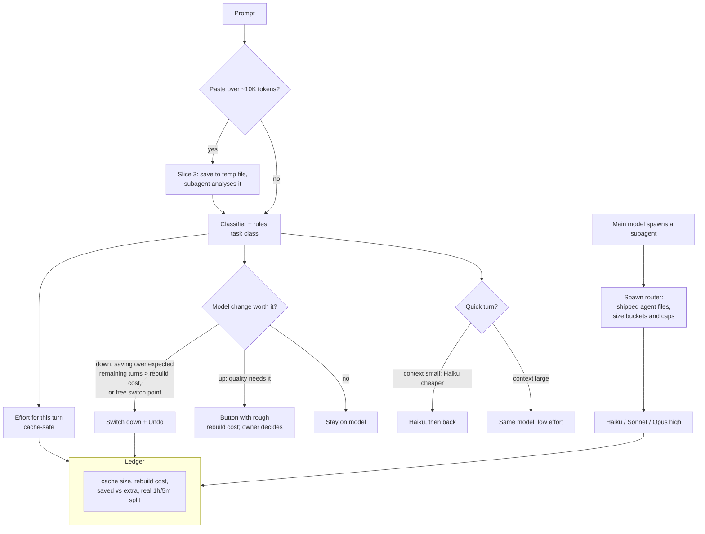

# Router v3 plan: cache-aware token economy

Goal: top quality at the lowest price, counting how the prompt cache works. Effort is the everyday lever; the model moves only when the cache math says it pays, or the owner asks for more quality. Decisions taken with the owner on 2026-11-25. Terms: [GLOSSARY.md](../GLOSSARY.md) (cache size, rebuild cost, free switch point, switch up / down).

Each slice below ships on its own, fully tested and evaluated, so work can stop after any slice when the weekly limit runs low.

## What we know about the cache

Prices, as multiples of the model's input price (Anthropic docs, 2026-11):

| | Cost |
|---|---|
| Write, 5-minute entry | 1.25x |
| Write, 1-hour entry | 2x |
| Read | 0.05x on Opus 5.5 and Sonnet 5.5, 0.1x on most others, 0.025x on Fable 5.1/5.2 |
| Timer | each read restarts it for free; it runs from the start of the request |

Haiku 5.5 prices every token at the higher rate once a prompt passes 100K tokens.

Measured on real Claude Code transcripts (engine 2.1.33x, 166K main-chat request pairs):

1. **Effort changes keep the cache.** 255 same-model effort changes read 99.7% of the context from cache (median), the same as unchanged turns. Low and xhigh have few samples. `guardCache` already turns auto effort off if this ever breaks.
2. **A model switch rewrites most or all of the cache** (17 cases; some kept ~50K tokens, not explained). Going back to the first model within the hour has never been observed.
3. **Compaction** (552 cases): the first request after it reads ~50K (system prompt and tools) and writes ~65K. So a switch right after compaction costs only ~50K extra tokens of writes.
4. **TTL:** the main chat writes 1-hour entries, subagents 5-minute ones.
5. **The prompt hook can drop or rewrite the prompt** (`PromptSubmitResult` has `text` and `drop`), except slash commands.

## Map

## Slice 1: cache-aware model switching

1. Per turn, the router keeps **cache size** (input + cache read + cache write of the last step) and computes the **rebuild cost** on a candidate model (cache size x its write price, Haiku long-context rate above 100K). Both are shown on the Board.
2. **Switch down** rule (ski rental with a prediction):
   - break-even turns b = rebuild cost / per-turn saving;
   - expected remaining turns N = the 25th percentile of remaining life from a survival curve (Kaplan-Meier) of past sessions at this session's age, capped by the turns left until the next compaction;
   - switch when N >= b; at a free switch point (just after compaction, or the cache is cold after a pause longer than its timer) the rebuild is due anyway, so b is near zero;
   - no history yet: switch only after the extra spend on the dearer model has reached the rebuild cost (the classic rule, never worse than 2x the best choice).
3. **Switch up** never happens by itself: a button with the rough rebuild cost in dollars.
4. **Quick turns** go to Haiku only while Haiku's rebuild is cheaper than the same turn on the chat's model; otherwise the chat's model at the class's effort. Today this is a fixed cap (`SWITCH_MAX_CONTEXT`, 90K tokens, set from Haiku's 100K price step); slice 1 computes it from the cache size and live prices.
5. **One decision, not two.** The class names a whole tier (model and effort together). If that tier's model is cheaper than the chat's, the switch rule above decides whether to move; a move takes the class's effort with it at no extra cache cost. If the move doesn't pay, the turn runs the class's effort on the current model.
6. Ledger fixes found by comparing with ccusage: read the real 1h/5m write split where the engine gives it; flag unpriced models in the ledger and in `check-savings.mjs` instead of pricing them as Opus or $0; in `check-savings.mjs` keep the line with the most tokens per message and dedupe across files.
7. Find where Haiku quick-turn calls are counted (they are not in main transcripts) before trusting quick-turn numbers.

Tests: unit tables for rebuild cost and break-even (prices x sizes x TTL), the survival curve on fixtures, the switch rule at each branch, mutations for every comparison. UI: Board HTML snapshot tests plus one look in the browser pane.

Eval, $0: replay every past transcript. Per session, compare the rule with never switching, always switching, and the best switch in hindsight; build the curve without the session being scored (leave one out). **Gate:** total cost below never switching, no session above 2x the hindsight best, no floor broken. Quality stays covered by the calibrated class rules already gated in `fast.mjs`.

One paid check, with the owner's OK first: a deliberate A, B, A switch to see whether A's old cache is read again.

## Slice 2: delegation to cheap subagents

1. The plugin ships agent files: a web researcher (Haiku) and a document reader (Sonnet), with sharp descriptions so the main model picks them itself. The tool list stays fixed, so the cache is never broken. No per-turn reminder, no orchestrator agent: the existing spawn router handles briefs that don't use them.
2. **Size buckets** from what is known before spawning (paste or file size in tokens, number of URLs, search vs read). Each bucket maps to a model and a cap (fetches, tokens). Unknown size: the bucket's model, no prediction.

Status 2026-11-25: shipped with deterministic tests (`bucket`, `sizeOf`, `briefPaths` in `policy.ts`; the spawn branch in `register.tsx`). The budgets and the 50K line are starting values; the Haiku eval below sets them once the Docker harness exists.

Tests: bucket tables, spawn-routing cases, mutations. Eval: API runs on Haiku up to $5, in the Docker harness below; any Sonnet or Opus answer or judge needs the owner's OK with its cost.

## Slice 3: big-paste offload

1. A prompt over ~10K tokens is dropped by the prompt hook and replaced by: the owner's own words outside the paste, the analysis from a subagent (Haiku for extract/find under 50K tokens, Sonnet for judgment), the temp file path, and a note of what the analysis left out.
2. "raw" or "keep it" in the prompt skips it. Slash commands are left alone.
3. If anything fails (file write, subagent, timeout), the original prompt goes through unchanged with a short note.
4. A later Read of the saved file counts as a miss and is subtracted from saved.
5. Temp files go to the session scratch folder and are deleted at session end.

Status 2026-11-25: shipped with deterministic tests: the size boundary (ASCII and Cyrillic, one token either side), the skip words, the person-only rule, fail-open on a failed or empty answer, the miss on a later Read, and the real delete script on temp files (`db.check.mjs`). The pastes folder is `~/.claude/router/pastes/` (a plugin can't see Claude Code's own scratch folder). Not done yet: the planted-fact eval below, which needs the API harness. The analysis model is one `$.model.complete` call, not a subagent: the paste is already in hand, so no tools are needed.

Tests: the size boundary (one token either side, multibyte text), the skip words, the fail-open paths, Windows paths with spaces, cleanup. Eval: planted-fact pastes (how many questions the analysis alone answers), scored with the Jev, then Opus judge cascade (`evals/calibrate/`) on a public summary-faithfulness gold set from Hugging Face with a permissive licence, chosen and calibrated in this slice. Haiku under $5; Opus fallback verdicts need the owner's OK.

## Slice 4: ideas from the tool studies

Clean room: ideas only, no code or text copied (several of these tools are source-available, not open source).

1. A lint for CLAUDE.md and skill lines that break the cache (dates, timestamps, ids near the top).
2. Real and estimated savings shown apart, never summed (we already keep saved and extra apart).
3. Fast-mode pricing (`usage.speed`), if the owner ever uses fast mode.
4. A check that warns when the plugin's hooks are not loaded.

Each idea ships only with its own deterministic test.

Added 2026-11-25 from a web study (public docs and write-ups; savings figures found are vendor claims with no control, so each idea needs its own eval):

**Measured 2026-11-25 on a week of the owner's transcripts** (289 main chats, free script): cache reads are about 69% of spend in price units (reads 1714, 1-hour writes 527, output 242); a main step re-reads about 280K tokens on average. Of cache writes, 44% come from resuming after more than an hour idle (443 resumes, about 261K tokens each), 40% are normal growth, 10% follow compaction, and model switches are 0.5%. Trimming tool results over 8K characters would cut only 0.8% of reads (Bash) and Read results can't be trimmed safely, because Claude Code already caps big outputs. So the lead became item 6 below, shipped as **Compact after a break** (an offer, never automatic, gated on paying back within 30 steps). Item 5 is demoted.

**Correction (2026-11-25, later the same day).** The two runs above and below counted each step several times: Claude Code writes one transcript line per content block, each carrying the whole step's usage (about 2.5 lines per step), and forked or resumed chats copy earlier steps into a new file. Deduplicated by message id across files (as `router/bin/check-savings.mjs` does), two weeks of main chats are 1,431 sessions, 36K steps, **$3,400**. Idle gaps over an hour before a step with over 20K of context: **270**, costing **$665** in rebuilds; keep-awake would have cost 4h $124, **12h $104**, 24h $107. So keep-awake still saves about 84% of rebuild cost and 12h stays the default, but the dollar figures below are about 5x too high. Spend by context: under 200K 33%, 200-400K 57%, 400-600K 5%, over 600K 5%. The shares in the next paragraph's last sentences (79% over 200K, 39% over 400K) are wrong; use these.

**Keep awake (shipped 0.8.2, owner's call 2026-11-25, replacing "keep-warm pings" in Set aside).** Two weeks of main chats (1,686 transcripts, $15.2K at API prices, free script priced with this plugin's own functions): 1,118 idle gaps over an hour, median context about 280K, cost $3,287 in rebuilds. The same gaps with keep-awake for N hours, then a warm compaction: 2h $1,013, 4h $790, 8h $634, **12h $568**, 24h $546, 48h $599. So 12 hours is the default. Gaps: 1-2h 422, 2-4h 234, 4-8h 198, 8-12h 103, 12-24h 86, over a day 75. Other facts from the same run: 79% of main spend is in steps with over 200K of context (39% over 400K); the top 10% of sessions are 95% of main spend; 70 sessions passed 500K. The nudge goes at 50 minutes, under Claude Code's own idle compaction (about 54 minutes, 200K floor, 1-hour cache only; the transcripts show it does not fire for the owner, since resumes write the full chat).

**Next candidates from the 2026-11-25 study and measurements** (each needs the owner's decision; the first one is where most of the remaining money is):
- **A smaller auto-compact window.** Claude Code compacts native-1M chats only near 967K (`autoCompactWindow`, `/autocompact 300k`, `CLAUDE_CODE_AUTO_COMPACT_WINDOW`; `CLAUDE_AUTOCOMPACT_PCT_OVERRIDE` is unreliable per GitHub issues). Long-context studies (Chroma "context rot", Anthropic's context-engineering post) say smaller context tends to answer better too, but none tested 2026 models at 1M. **Replayed 2026-11-25 (free, deduplicated, two weeks, $3,400 of main spend).** Each main chat was replayed as if it compacted, cache warm, whenever its context passed W: a compaction reads the chat, writes a 5K summary (the median of 683 real summaries) and leaves 113K (the median context right after 195 real compactions: system prompt, tools, summary, kept files); every later step re-reads that much less. "Re-read" is the context the model pulls back in after a compaction (files read again), not measurable from transcripts, so it is a range. Net saving as a share of main spend:

| W | compactions | re-read 0 | re-read 30K | re-read 60K |
|---|---|---|---|---|
| 200K | 453 | 7.9% | -7.0% | -45.6% |
| 300K | 191 | 8.0% | 4.4% | 0.5% |
| 400K | 16 | 4.0% | 3.4% | 2.8% |
| 600K | 5 | 2.4% | 2.2% | 2.0% |

Verdict: a small win, not the big one. 300K is the only window that stays positive across the range (about $150-270 per two weeks at today's use, 45 sessions affected); 200K turns into a loss as soon as the model re-reads anything. The saving is capped because a compacted chat still starts at 113K, and most spend already sits at 200-400K. Re-read measured on the same transcripts: context growth in the 8 steps after each of 189 real compactions, minus growth in the 8 steps before: median 3K, p25 -1K, p75 9K. So the re-read is small and 300K lands near **7% of main spend** (about $240 per two weeks); 200K near 3%. Caveat: most real compactions were at a task break (manual or near 967K), and an earlier automatic one mid-task likely re-reads more. Still open: a quality check on what summaries lose, which costs money. Until then the plugin should at most mention `/autocompact 300k` in the cheat sheet, not set it.
- **Handoff file before a clear**: a structured progress file, then `/clear`, then resume from it. Widely used, never measured against `/compact`. Our evals could be the first head-to-head.
- **Suggest `/clear` after repeated failures** (the unhappy-reply count already exists); Claude Code's docs advise it after two failed corrections.
- RTK (Rust Token Killer) and similar Bash trimmers: wrong target for this profile (big tool results are 1-2% of reads).

5. **Trim big tool results, losslessly recoverable** (demoted: about 1-2% of reads at best, see above). A `tool.call` hook may return its own `result` after the tool ran, and the model reads that instead (checked in the plugin API types). For a Read, Grep, Bash or WebFetch result over a size line: keep head and tail, collapse repeated log lines, pass errors through untouched, save the full text under `~/.claude/router/` and append its path, the same pattern as big pastes. Every kept result is re-read on each later turn, so this is likely the biggest remaining saving. Eval: planted-fact tasks like `paste/run.mjs`, where the answer needs a line from a trimmed result.
6. **Compaction timing.** Compacting while the cache is warm reads the cached prefix; after the cache expires it pays for everything again. Offer "compact now while it's warm" at a task break, and hold an auto-compact while the cache is cold if the hooks allow it.
7. **Avoidable cache breaks at run time.** Warn before what rebuilds the cache: a skill or agent with a model override, a fast-mode toggle, an MCP server added mid-chat. Extends item 1 from files to actions.
8. **Cache TTL advice.** API-key users get 5-minute entries in the main chat, and subagents get 5 minutes by default. The plugin can't change that, but it can read the 1h/5m split in usage and suggest the setting when the math says so.
9. **Fork or fresh subagent.** A fork reads the parent's warm cache, but a fresh subagent doesn't. Prefer a fork when the parent prefix is large and warm and the task needs that context.

Checked and set aside: summarising every tool result with a model (costs more than it saves on small outputs), prose-trimming styles (small share, risks quality), capping thinking tokens (effort routing already covers it), API-only context-editing headers (the plugin can't send them).

## How evals run

1. Plain API evals (classifier, judge, summary scoring) are Node scripts that call the Messages API with the owner's API key: Batch API where latency doesn't matter, prompt caching on shared prefixes, every answer stored in `evals/work/eval.db` and paid once. `node fast.mjs` replays everything for $0.
2. Evals that run Claude Code itself go in a **fresh Docker container per run**: Linux, Node, Claude Code, the plugin installed from the repo (working copy or tag), nothing mounted from the host's `~/.claude`. `ANTHROPIC_API_KEY` comes from the host environment at run time (billed to the API platform, never the subscription), and is never written to the image or printed. The container is deleted after the run; answers go only to `eval.db`.
3. Spend: Haiku runs up to $5 each without asking. Any Sonnet, Opus or Fable answer or judge needs the owner's OK with its cost and the decision it buys.

## Set aside

- A separate orchestrator agent: it costs a model call per task and has its own cache; the main model already decides when to spawn.
- Per-turn delegation reminders: tokens on every turn.
- ~~Keep-warm pings~~: reversed 2026-11-25 by measurement and the owner's call; shipped as Keep awake (see slice 4).
- Rewriting shell commands to filter their output: the plugin cannot run a shell; revisit only if tool hooks can replace tool results.
