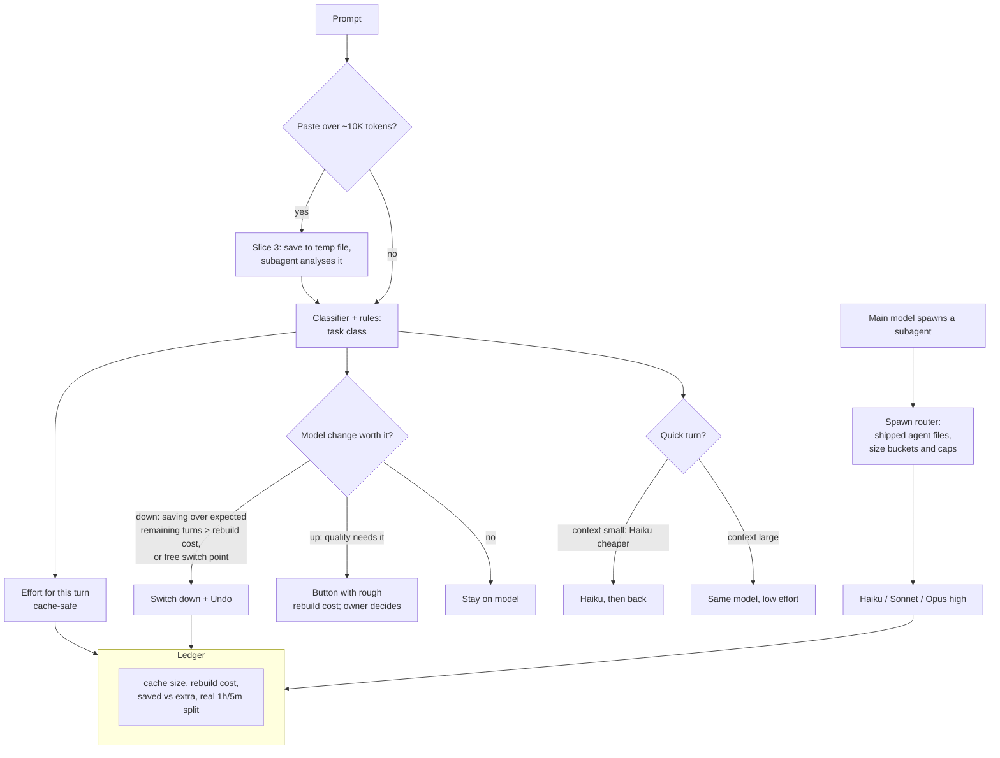

# Router v3 plan: cache-aware token economy

Goal: top quality at the lowest price, counting how the prompt cache works. Effort is the everyday lever; the model moves only when the cache math says it pays, or the owner asks for more quality. Decisions taken with the owner on 2026-11-25. Terms: [GLOSSARY.md](../GLOSSARY.md) (cache size, rebuild cost, free switch point, switch up / down).

Each slice below ships on its own, fully tested and evaluated, so work can stop after any slice when the weekly limit runs low.

## What we know about the cache

Prices, as multiples of the model's input price (Anthropic docs, 2026-11):

| | Cost |
|---|---|
| Write, 5-minute entry | 1.25x |
| Write, 1-hour entry | 2x |
| Read | 0.05x on Opus 5.5 and Sonnet 5.5, 0.1x on most others, 0.025x on Fable 5.1/5.2 |
| Timer | each read restarts it for free; it runs from the start of the request |

Haiku 5.5 prices every token at the higher rate once a prompt passes 100K tokens.

Measured on real Claude Code transcripts (engine 2.1.33x, 166K main-chat request pairs):

1. **Effort changes keep the cache.** 255 same-model effort changes read 99.7% of the context from cache (median), the same as unchanged turns. Low and xhigh have few samples. `guardCache` already turns auto effort off if this ever breaks.
2. **A model switch rewrites most or all of the cache** (17 cases; some kept ~50K tokens, not explained). Going back to the first model within the hour has never been observed.
3. **Compaction** (552 cases): the first request after it reads ~50K (system prompt and tools) and writes ~65K. So a switch right after compaction costs only ~50K extra tokens of writes.
4. **TTL:** the main chat writes 1-hour entries, subagents 5-minute ones.
5. **The prompt hook can drop or rewrite the prompt** (`PromptSubmitResult` has `text` and `drop`), except slash commands.

## Map

## Slice 1: cache-aware model switching

1. Per turn, the router keeps **cache size** (input + cache read + cache write of the last step) and computes the **rebuild cost** on a candidate model (cache size x its write price, Haiku long-context rate above 100K). Both are shown on the Board.
2. **Switch down** rule (ski rental with a prediction):
   - break-even turns b = rebuild cost / per-turn saving;
   - expected remaining turns N = the 25th percentile of remaining life from a survival curve (Kaplan-Meier) of past sessions at this session's age, capped by the turns left until the next compaction;
   - switch when N >= b; at a free switch point (just after compaction, or the cache is cold after a pause longer than its timer) the rebuild is due anyway, so b is near zero;
   - no history yet: switch only after the extra spend on the dearer model has reached the rebuild cost (the classic rule, never worse than 2x the best choice).
3. **Switch up** never happens by itself: a button with the rough rebuild cost in dollars.
4. **Quick turns** go to Haiku only while Haiku's rebuild is cheaper than the same turn on the chat's model; otherwise the chat's model at the class's effort. Today this is a fixed cap (`SWITCH_MAX_CONTEXT`, 90K tokens, set from Haiku's 100K price step); slice 1 computes it from the cache size and live prices.
5. **One decision, not two.** The class names a whole tier (model and effort together). If that tier's model is cheaper than the chat's, the switch rule above decides whether to move; a move takes the class's effort with it at no extra cache cost. If the move doesn't pay, the turn runs the class's effort on the current model.
6. Ledger fixes found by comparing with ccusage: read the real 1h/5m write split where the engine gives it; flag unpriced models in the ledger and in `check-savings.mjs` instead of pricing them as Opus or $0; in `check-savings.mjs` keep the line with the most tokens per message and dedupe across files.
7. Find where Haiku quick-turn calls are counted (they are not in main transcripts) before trusting quick-turn numbers.

Tests: unit tables for rebuild cost and break-even (prices x sizes x TTL), the survival curve on fixtures, the switch rule at each branch, mutations for every comparison. UI: Board HTML snapshot tests plus one look in the browser pane.

Eval, $0: replay every past transcript. Per session, compare the rule with never switching, always switching, and the best switch in hindsight; build the curve without the session being scored (leave one out). **Gate:** total cost below never switching, no session above 2x the hindsight best, no floor broken. Quality stays covered by the calibrated class rules already gated in `fast.mjs`.

One paid check, with the owner's OK first: a deliberate A, B, A switch to see whether A's old cache is read again.

## Slice 2: delegation to cheap subagents

1. The plugin ships agent files: a web researcher (Haiku) and a document reader (Sonnet), with sharp descriptions so the main model picks them itself. The tool list stays fixed, so the cache is never broken. No per-turn reminder, no orchestrator agent: the existing spawn router handles briefs that don't use them.
2. **Size buckets** from what is known before spawning (paste or file size in tokens, number of URLs, search vs read). Each bucket maps to a model and a cap (fetches, tokens). Unknown size: the bucket's model, no prediction.

Status 2026-11-25: shipped with deterministic tests (`bucket`, `sizeOf`, `briefPaths` in `policy.ts`; the spawn branch in `register.tsx`). The budgets and the 50K line are starting values; the Haiku eval below sets them once the Docker harness exists.

Tests: bucket tables, spawn-routing cases, mutations. Eval: API runs on Haiku up to $5, in the Docker harness below; any Sonnet or Opus answer or judge needs the owner's OK with its cost.

## Slice 3: big-paste offload

1. A prompt over ~10K tokens is dropped by the prompt hook and replaced by: the owner's own words outside the paste, the analysis from a subagent (Haiku for extract/find under 50K tokens, Sonnet for judgment), the temp file path, and a note of what the analysis left out.
2. "raw" or "keep it" in the prompt skips it. Slash commands are left alone.
3. If anything fails (file write, subagent, timeout), the original prompt goes through unchanged with a short note.
4. A later Read of the saved file counts as a miss and is subtracted from saved.
5. Temp files go to the session scratch folder and are deleted at session end.

Tests: the size boundary (one token either side, multibyte text), the skip words, the fail-open paths, Windows paths with spaces, cleanup. Eval: planted-fact pastes (how many questions the analysis alone answers), scored with the Jev, then Opus judge cascade (`evals/calibrate/`) on a public summary-faithfulness gold set from Hugging Face with a permissive licence, chosen and calibrated in this slice. Haiku under $5; Opus fallback verdicts need the owner's OK.

## Slice 4: ideas from the tool studies

Clean room: ideas only, no code or text copied (several of these tools are source-available, not open source).

1. A lint for CLAUDE.md and skill lines that break the cache (dates, timestamps, ids near the top).
2. Real and estimated savings shown apart, never summed (we already keep saved and extra apart).
3. Fast-mode pricing (`usage.speed`), if the owner ever uses fast mode.
4. A check that warns when the plugin's hooks are not loaded.

Each idea ships only with its own deterministic test.

## How evals run

1. Plain API evals (classifier, judge, summary scoring) are Node scripts that call the Messages API with the owner's API key: Batch API where latency doesn't matter, prompt caching on shared prefixes, every answer stored in `evals/work/eval.db` and paid once. `node fast.mjs` replays everything for $0.
2. Evals that run Claude Code itself go in a **fresh Docker container per run**: Linux, Node, Claude Code, the plugin installed from the repo (working copy or tag), nothing mounted from the host's `~/.claude`. `ANTHROPIC_API_KEY` comes from the host environment at run time (billed to the API platform, never the subscription), and is never written to the image or printed. The container is deleted after the run; answers go only to `eval.db`.
3. Spend: Haiku runs up to $5 each without asking. Any Sonnet, Opus or Fable answer or judge needs the owner's OK with its cost and the decision it buys.

## Set aside

- A separate orchestrator agent: it costs a model call per task and has its own cache; the main model already decides when to spawn.
- Per-turn delegation reminders: tokens on every turn.
- Keep-warm pings: they spend subscription calls to save cache, and our main chat already writes 1-hour entries.
- Rewriting shell commands to filter their output: the plugin cannot run a shell; revisit only if tool hooks can replace tool results.
