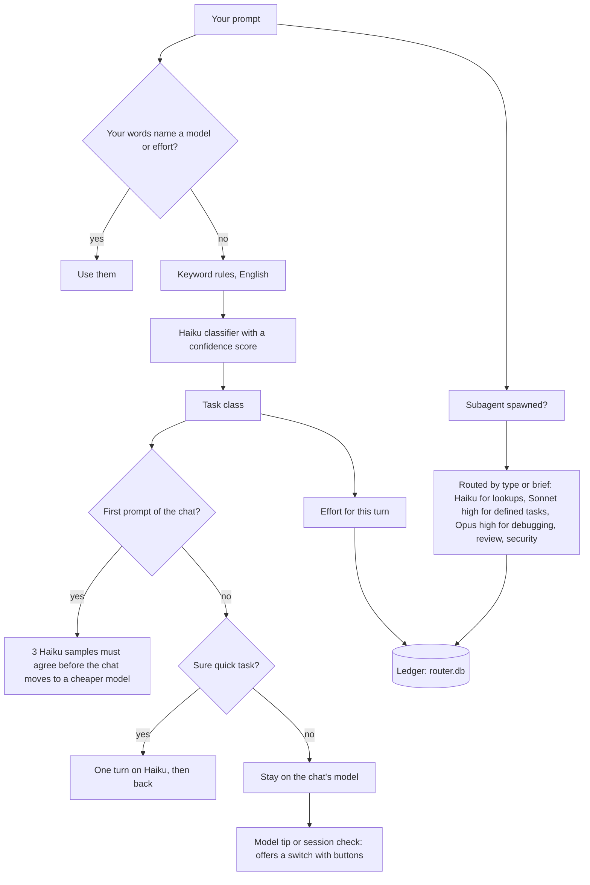

# How it works

## The rules that never bend

1. **Effort first.** Changing effort keeps the prompt cache, so it is the router's main tool.
2. **The model moves down only when it pays.** A new model has to write the whole chat into its own cache. The router moves down by itself only when that cost comes back: at the first prompt, right after a compaction, after an hour idle, or when chats like yours run long enough.
3. **Never up by itself.** Moving up is always a button that shows roughly what the switch costs.
4. **Floors.** Production-code investigation (debugging, code review, security review) stays on Opus high or above. Classes marked `floor` never go below the default.
5. **Fable is never picked automatically.**
6. **Your words win.** "use sonnet", "high effort", "think harder", and "from now on" to keep it for the chat.

## When you're unhappy

One Haiku sample reads your reply after each answer. The first unhappy reply changes nothing, so one misread costs nothing. The second raises effort one step. The fourth raises it again and offers the next model up. A new task starts calm.

## What it measures against

Every figure is against **no router**: the model and effort that would have run without the plugin, at the same tokens. Saved and extra spend are kept apart, so cheap subagents can't hide a dearer turn.
